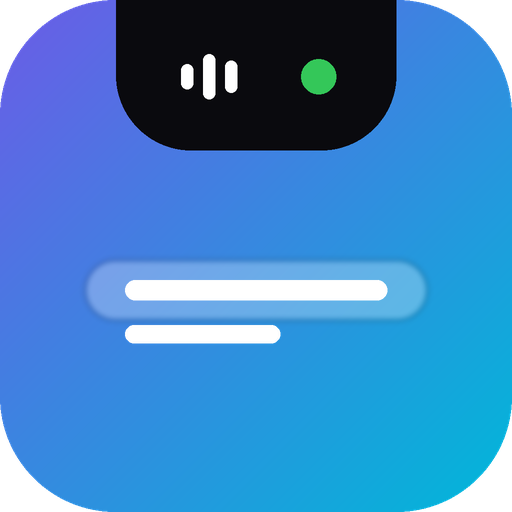

<div align="center">



# Notchly

**A dynamic island-inspired notch for Windows.**

A sleek, expandable top-center desktop bar for music, calendar events, shortcuts, and system controls — all in one place.


</div>

---

## ✨ Features

- **Dynamic notch:** A compact top-center bar that expands on hover, click, or `Ctrl + Alt + N`.
- **Now playing:** Album artwork, song details, animated music bars, and playback controls.
- **Calendar at a glance:** Upcoming events in the compact bar, a monthly calendar, daily agenda, and event reminders.
- **Multiple calendars:** Add iCal (`.ics`) URLs or local files, including feeds from Google Calendar, Outlook, and iCloud.
- **Quick file shelf:** Drag and drop files for convenient access.
- **App shortcuts:** Pin apps, shortcuts, or files to the Apps tab.
- **System overview:** Monitor CPU, RAM, and battery, plus quick actions for volume, mute, screenshots, and locking Windows.
- **Personalization:** Configure appearance, behavior, tabs, collapsed-bar information, and calendar settings.
- **Startup greeting:** An animated hello when Notchly launches.

## 🖥️ Interface

| View | What's inside |
| --- | --- |
| **Collapsed notch** | Now playing, next calendar event or date/time, battery, animated music bars |
| **Home** | Media player and file shelf |
| **Apps** | Pinned applications and shortcuts |
| **Calendar** | Month view, selected-day agenda, and events |
| **System** | CPU, RAM, battery, and quick actions |
| **Settings** | General, Appearance, Behavior, Calendar, Collapsed bar, Tabs, About |

> Screenshots can be added here later. Suggested paths: `Assets/screenshots/collapsed.png`, `expanded.png`, and `calendar.png`.

## 🚀 Getting started

### Requirements

- Windows 10 version 2004 (build 19041) or later, or Windows 11
- [.NET 8 SDK](https://dotnet.microsoft.com/download/dotnet/8.0) for building from source

### Run from source

```powershell
git clone https://github.com/YOUR_USERNAME/Notchly.git
cd Notchly
dotnet run
```

Replace `YOUR_USERNAME` with your GitHub username. Run the commands from the folder containing `Notchly.csproj`.

### Build a standalone Windows executable

```powershell
dotnet publish -c Release -r win-x64 --self-contained true -p:PublishSingleFile=true
```

The published files are placed under `bin/Release/net8.0-windows10.0.19041.0/win-x64/publish/`. You can distribute the published output through [GitHub Releases](../../releases) when a release is available.

## 📅 Calendar setup

1. Open **Settings → Calendar** in Notchly.
2. Paste a private iCal (`.ics`) feed URL or choose a local `.ics` file.
3. Add additional calendars if needed.
4. View events in the Calendar tab and see upcoming events in the collapsed notch.

Calendar feeds may come from Google Calendar, Outlook / Microsoft 365, or iCloud. Notchly supports recurring and all-day events, time zones, and an offline calendar copy.

**Privacy note:** Private iCal links can grant access to your calendar data. Treat them like passwords. Notchly stores configured links locally in `%AppData%\Notchly\settings.json`. Never commit that settings file or private calendar URLs to GitHub.

## ⌨️ Controls

| Action | How |
| --- | --- |
| Expand the notch | Hover, click, or press `Ctrl + Alt + N` |
| Open Settings | Click the gear in the expanded bar or double-click the tray icon |
| Pin an item | Drag a file, shortcut, or app into its corresponding shelf |

## 🛠️ Tech stack

- **Language:** C#
- **Desktop UI:** Windows Presentation Foundation (WPF), XAML
- **Runtime:** .NET 8, targeting Windows 10 build 19041+
- **Platform:** Windows 10 / Windows 11

## 📁 Project structure

```text
Notchly/
├── Assets/
│   ├── logo.png
│   └── logo.ico
├── App.xaml
├── App.xaml.cs
├── AppSettings.cs
├── CalendarService.cs
├── IcsParser.cs
├── MainWindow.xaml
├── MainWindow.xaml.cs
├── MediaService.cs
├── SettingsWindow.xaml
├── SettingsWindow.xaml.cs
├── ShelfItem.cs
├── SystemStats.cs
├── Notchly.csproj
└── README.md
```

## 🤝 Contributing

Suggestions, bug reports, and pull requests are welcome. Open an issue to discuss significant changes before submitting a pull request.

## 📄 License & ownership

**Copyright © 2026 Mohamed Musthaq Muaadh.**

Notchly's **source code** is licensed under the **GNU General Public License v3.0 only (GPL-3.0-only)**. See [LICENSE](LICENSE) for the complete license terms.

You may use, study, modify, and redistribute the source code under the GPL-3.0 terms. When distributing modified versions, you must comply with the GPL, including providing corresponding source code and preserving required notices. Commercial use and distribution are permitted by the GPL.

**Branding exception:** The **Notchly name, logo, and original branding artwork** are **not licensed under GPL-3.0**. They remain © 2026 Mohamed Musthaq Muaadh, all rights reserved, except where permission is expressly granted. See [BRANDING.md](BRANDING.md). This restriction applies to branding assets, not the GPL-licensed source code. The project includes these assets for identification; their presence in the repository does not grant a general right to reuse them in forks or derivative branding.

Forks and modified distributions must not imply they are official Notchly releases or endorsed by the project owner.

---

<div align="center">

**Notchly — Your essentials, one notch away.**

Created by **Mohamed Musthaq Muaadh**

</div>
